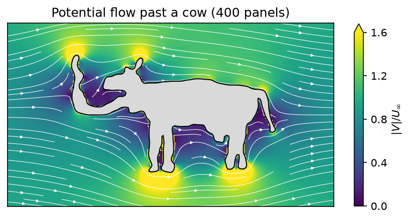
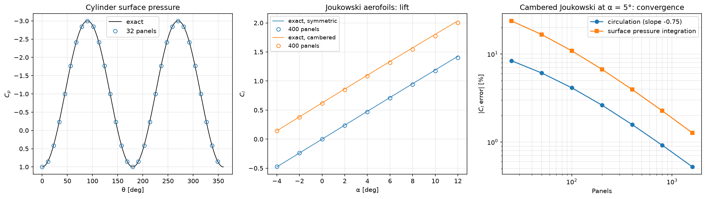
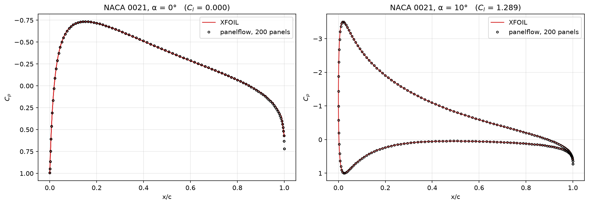
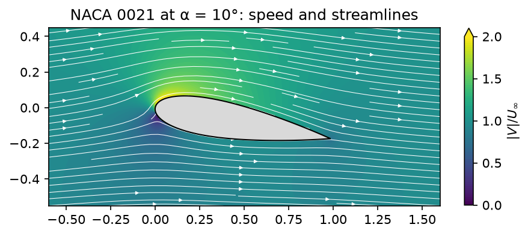

# potential-flow-panels

A 2D panel method for inviscid, incompressible flow around arbitrary bodies, from a cylinder to a
NACA aerofoil to anything you can draw.



This started as aerodynamics coursework at the University of Sydney, where I wrote the solver and
then kept going: an image tracer that turns a line drawing into panels, a NACA 4-digit generator
with camber, and a validation suite against exact solutions and XFOIL.

## Method

**Hess–Smith panel method.** The body surface is split into straight panels. Each panel carries a
constant-strength source distribution, and all panels share one constant-strength vortex
distribution. The unknowns come from:

- **flow tangency**: zero normal velocity at each panel's midpoint (N equations)
- **the Kutta condition**: equal tangential speed on the two trailing-edge panels, so the flow
  leaves the trailing edge smoothly (1 equation, lifting bodies only)

Lift comes from the total circulation (Kutta–Joukowski) or from integrating surface pressure.
Panel influence uses the closed-form velocity of a constant-strength line source or vortex, and the
self-induced terms use their analytic limits, because the integrals are discontinuous exactly on
the panel.

```python
import numpy as np
import panelflow as pf
from panelflow.geometry import naca4

geom = naca4("2412", n_panels=160)
alpha = np.radians(4)
sigma, gamma = pf.solve(geom, alpha, kutta=True)

cl = pf.kutta_joukowski_cl(geom, gamma)
cp = pf.surface_cp(geom, gamma, alpha=alpha)
```

| Module | Contents |
|---|---|
| `panelflow/influence.py` | Velocity induced by a constant-strength source or vortex panel (vectorised) |
| `panelflow/solver.py` | System assembly, Kutta condition, solve, velocity field anywhere, wind-axes helper |
| `panelflow/pressure.py` | Surface Cp, pressure-integrated Cl/Cd, Kutta–Joukowski Cl |
| `panelflow/geometry.py` | Cylinder, NACA 4-digit (cambered), Joukowski aerofoils with exact Cl, and `from_image` |
| `panelflow/plotting.py` | Streamline and speed-contour plots |

### Panelling a drawing

`geometry.from_image` thresholds a line drawing, closes small gaps in the ink, fills the interior,
traces the outer contour, smooths it, and resamples it to evenly spaced panels oriented clockwise.
The cow above is `data/cow.png`: 400 panels, solved in a few tens of milliseconds.

## Validation



- **Cylinder**: surface Cp matches the exact 1 − 4 sin²θ to within 4×10⁻⁶, and net force is zero
  to machine precision (d'Alembert's paradox).
- **Joukowski aerofoils**: lift against the exact conformal-mapping solution for symmetric and
  cambered sections across −4° to 12°.
- **Convergence**: lift error falls steadily with panel count, from 8.4% at 25 panels to 0.5% at
  1600 (order ≈ 0.75). Joukowski sections have a cusped trailing edge, which is the hardest case
  for constant-strength panels. Integrated surface pressure converges more slowly than
  circulation, since it inherits the error in every local velocity.



- **NACA 0021 vs XFOIL**: surface pressure at α = 0° and 10° lies on top of XFOIL's.



### Tests

```bash
pip install -r requirements.txt
pytest
```

32 tests covering:

- **Panel influence functions**: the σ/2 and γ/2 jumps at the panel, symmetry and antisymmetry
  across it, point-source and point-vortex far fields, the closed-form vortex velocity on the
  perpendicular bisector, and agreement between vectorised and scalar calls.
- **Solver**: no flow through the surface, net source strength tending to zero, zero lift for a
  symmetric section at α = 0, positive lift from camber at α = 0, and a lift slope close to 2π for
  a thin section.

## Examples

```bash
python examples/cow.py
python examples/validation.py
python examples/naca_vs_xfoil.py
```

## Limits

Potential flow has no viscosity. It predicts lift well before stall but gives zero pressure drag,
and it has no separation. That's why the cow's wake looks so tidy.
